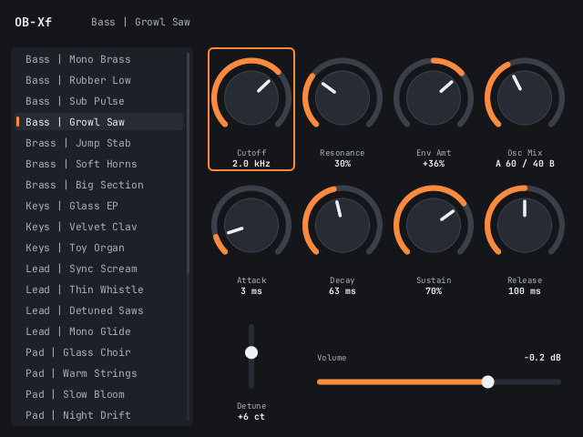

# tiny-pixel

A small, antialiased UI library that draws into pixel buffers it does not own.

tiny-pixel is for small screens driven by buttons rather than a mouse: handheld
devices and embedded hardware hosts that give a plugin an XRGB8888 framebuffer
and a d-pad. It keeps a persistent component tree, moves focus between controls
with the d-pad, and redraws only what changed.

The core library needs the C++20 standard library and one vendored header,
`stb_truetype.h`. It doesn't use SDL, freetype, harfbuzz, GL or any platform
SDK, and it has no global state, so several plugin instances can share a
process.



## Features

- Antialiased rectangles, rounded rectangles, circles, arcs and lines
- TrueType text through stb_truetype, with kerning and UTF-8
- A component tree with clipping, d-pad focus navigation and key repeat
- Partial redraw: a change marks only its own area dirty, and `render` takes the
  buffer's age so a host that swaps between buffers still gets correct partial
  updates
- Widgets: `Knob`, `Slider`, `Label` and a scrolling `PresetList`
- An optional embedded font (JetBrains Mono, OFL), so an app doesn't have to
  ship one

## Building

```sh
cmake -B build -DCMAKE_BUILD_TYPE=Release
cmake --build build --target tiny-pixel-tests obxf_shots
./build/tiny-pixel-tests
```

To use it from another project:

```cmake
add_subdirectory(libs/tiny-pixel)
target_link_libraries(my-plugin PRIVATE tiny-pixel::tiny-pixel tiny-pixel::default-font)
```

`tiny-pixel::default-font` is optional. Leave it out if you bring your own
`.ttf`.

| Option                       | Default            | Builds                                        |
|------------------------------|--------------------|-----------------------------------------------|
| `TINY_PIXEL_BUILD_TESTS`     | on when top level  | `tiny-pixel-tests` (Catch2, not built by `all`) |
| `TINY_PIXEL_BUILD_EXAMPLES`  | on when top level  | the OB-Xf example page and `obxf_shots`       |

## Usage

The app owns its components, usually as members. Fonts must outlive the root,
and the root must outlive the widgets, so declare them in that order.

```cpp
#include "tiny-pixel/tiny-pixel.h"
#include "tiny-pixel/default_font.h"

class Screen
{
  public:
    Screen()
    {
        root.theme().font = &font;

        cutoff.setBounds({20, 20, 96, 130});
        cutoff.setLabel("Cutoff");
        cutoff.setDefault(0.5f);
        cutoff.onChange = [](float v) { /* tell the engine */ };
        root.addChild(&cutoff);
        root.setFocus(&cutoff);
    }

    tpx::Root &ui() { return root; }

  private:
    static tpx::Font makeFont(float px)
    {
        auto ttf = tpx::fonts::jetbrainsMonoRegular();
        return tpx::Font(ttf.data(), ttf.size(), px);
    }

    tpx::Font font{makeFont(15)};
    tpx::Root root{640, 480};
    tpx::Knob cutoff;
};
```

### Drawing

The library never asks for a frame or owns a loop. It tells you when something
needs drawing, and draws when you hand it a buffer:

```cpp
// ask the host for a frame when the first change arrives
screen.ui().onNeedsFrame = [&] { host.requestFrame(); };

// in the host's render callback
tpx::Surface s{pixels, width, height, strideBytes};
screen.ui().render(s, bufferAge); // 0 if unknown, n if the buffer holds the frame from n renders ago
```

An idle UI costs nothing. Values set from the host with `setValue` repaint only
that control and don't fire `onChange`.

### Input

The host maps its buttons onto `tpx::Input` and passes press and release events
to `Root::input`. Call `Root::tick(dt)` regularly to drive key repeat.

- **Up, Down, Left, Right** move focus to the nearest control in that direction.
- **Edit held** turns the d-pad into adjustment: left and right make fine steps,
  up and down make coarse steps.
- **Edit tapped** on a preset list chooses the selected preset.
- **Encoder** events with a `delta` adjust the focused control directly.
- Anything nothing in the focus chain handles goes to `Root::onUnhandled`.

### Theming

`Root::theme()` holds the colours, corner radius, focus ring width, the fonts
used for normal, bold, small and value text, and the key repeat timings. If you
set only `font`, widgets use it for all their text. Call `setTheme` to replace
the theme and repaint everything.

## Example

`examples/obxf_page` builds the page in the screenshot above: a preset browser,
eight knobs and two sliders over a fake parameter set. `obxf_shots` drives it
through a scripted session of button presses and writes a PNG after each step:

```sh
./build/obxf_shots build/shots/obxf
```

Every PNG after the first comes from a partial redraw of the same buffer, so
the sequence also shows that the partial redraws are correct.

## License

MIT, see [LICENSE](LICENSE). JetBrains Mono is under the SIL Open Font License,
see `resources/fonts/JetBrainsMono-OFL.txt`. stb and Catch2 are vendored in
`libs/` under their own licenses.
